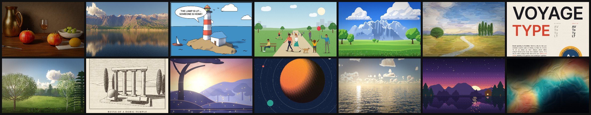

# atelier

**Let your LLM paint.**

LLMs can write, reason and code, but when you ask one for a picture it hands the job to an image model. atelier gives
the LLM itself the brush: it writes a short Python script, renders it, **looks at the result and fixes it**, until the
image is right. No image model is ever called: no diffusion, no image API, no key, no GPU. Every pixel comes from code
the LLM wrote, computed on the CPU.

That covers any style: photoreal 3D, oil and watercolour painting, anime-style painted landscapes, comics and
engravings, people, landscapes, posters and typography, pixel art, generative abstracts, and new styles the agent
works out itself from a reference. Under the hood: noise fields, vector shapes, a brush engine, effects,
an SDF path tracer, terrain erosion, a physical sky, posable figures, and tools that let the LLM inspect its own renders.

Website: <https://atelier.wexop.eu> · every image below was made by atelier from a script in [examples/](examples).



## Install

```bash
pip install git+https://github.com/Wexop/atelier
```

Python ≥ 3.11. Dependencies: numpy, pillow, opencv-python-headless, scipy, skia-python.

## Install the skill (for AI agents)

The skill is a folder: [SKILL.md](SKILL.md), a compact cheat sheet that teaches an agent the whole API and the
render → look → fix loop, plus [style guides](styles) the agent reads only when it needs them:

| guide | for |
|---|---|
| [anime](styles/anime.md) | painted anime landscapes: cel-shaded clouds, trees and mountains, rim light, god rays, sparkles |
| [oil](styles/oil.md) | oil painting from a colour study, watercolour washes |
| [photoreal](styles/photoreal.md) | path-traced still life and products, terrain landscapes, sea and sky |
| [comic](styles/comic.md) | ligne claire and toon from 3D, engraving, ink filters |
| [flat](styles/flat.md) | flat vector, posters, typography, people, silhouette scenes |
| [pixel](styles/pixel.md) | pixel art with palettes and dithering |
| [abstract](styles/abstract.md) | generative abstracts from warped fields |
| [planning](styles/planning.md) | **process** for complex pictures: written plan + focus, grey thumbnails scored side by side, build passes, hierarchy rules (example: [planned.py](examples/planned.py)) |
| [new-style](styles/new-style.md) | **any look not listed**: study it, map it to the toolbox, paint it, then save it as a new guide |

**If you are an AI agent:** run `pip install git+https://github.com/Wexop/atelier`, then read
<https://raw.githubusercontent.com/Wexop/atelier/main/SKILL.md> and follow it (it links to the style guides).

**Claude Code plugin** (recommended, gets updates):

```
/plugin marketplace add Wexop/atelier
/plugin install atelier@atelier
```

**Claude Code** (personal skill, available in every project):

```bash
git clone --depth 1 https://github.com/Wexop/atelier /tmp/atelier && mkdir -p ~/.claude/skills && rm -rf ~/.claude/skills/atelier && cp -r /tmp/atelier/.claude/skills/atelier ~/.claude/skills/ && rm -rf /tmp/atelier
```

Windows PowerShell:

```powershell
$t = "$env:TEMP\atelier"; git clone --depth 1 https://github.com/Wexop/atelier $t; New-Item -ItemType Directory -Force "$HOME\.claude\skills" | Out-Null; Remove-Item -Recurse -Force "$HOME\.claude\skills\atelier" -ErrorAction SilentlyContinue; Copy-Item -Recurse "$t\.claude\skills\atelier" "$HOME\.claude\skills\"; Remove-Item -Recurse -Force $t
```

For a single project, copy the folder to `.claude/skills/atelier/` instead (this repo already has it). Without the
`styles/` folder the skill still works: it fetches the guides from GitHub when it needs one.

**Claude.ai / Claude desktop:** zip the [`.claude/skills/atelier`](.claude/skills/atelier) folder (`SKILL.md` + `styles/`) and upload it in
*Settings → Capabilities → Skills*. The skill installs the package itself with the `pip install` line above.

**Updating:** nothing updates automatically. Package: `pip install -U git+https://github.com/Wexop/atelier`
(the version is bumped on every package change). Skill: re-run the `git clone` line above,
or re-upload the zip on Claude.ai.

## Quick start

```python
# night.py
from atelier import *

c = Canvas(1600, 1000)
c.fill(gradient([(0, "#0b1026"), (0.45, "#3b2a5a"), (0.68, "#f4a259")]))
c.layer(blend="screen").fill("white", mask=stars(70, seed=3) * top(0.5, soft=0.2))
c.circle(1180, 250, 44, fill="#fff4d6")
c.layer().fill_below(ridged(2.2, seed=1).ridge_line(y=0.74, amp=0.15), fbm(6).ramp(["#0c0c1a", "#1f1c34"]))
c.apply(bloom(0.8, 12), grain(0.03), vignette(0.3))
c.save("night.png")
```

```bash
atelier render night.py --preview          # fast 512 px look -> night_prev.jpg
atelier inspect night.py                   # contact sheet: value study, clipping, auto zooms on defects, metrics
atelier render night.py --crop 600,500,300,200   # full-res zoom on a region
atelier render night.py --grid --boxes --mark 880,230  # coordinate grid, layer bounds, target mark
atelier critique night.py                  # ranked problems + fixes: contrast, balance, tangents, placeholders, style mix, floating bases, near-miss seams, ambient light, grounding, hierarchy
atelier sheet a.py b.py c.py               # thumbnails / variants side by side with value studies and scores
atelier render night.py                    # final render
```

## What's inside

| module | contents |
|---|---|
| `core` | canvas, named layers (move / scale / flip / restack / hide by name, groups), 17 blend modes, masks, image import, export, previews |
| `field` | lazy procedural fields: perlin/simplex/value, fbm, ridged, worley, domain warp, patterns, gradients, palettes, 2.5D shading |
| `vector` | skia shapes, SVG paths, booleans, strokes/dashes, text with embedded fonts and GPOS kerning, text on a path, justified text boxes, title presets |
| `brush` | stroke engine (round, ink, chalk, bristle, oil with impasto, watercolour with glazing), scatter, hatching, pigment mixing, `paint_like` |
| `fx` | blur, bloom, glow, shadows, grading (curves, levels, colour balance, AgX), grain, halftone, pixelate + dithering, depth of field |
| `sdf` | 3D signed-distance primitives and ops, materials (bump, object-space textures, wear: smudges, scratches, dust, edge wear), fast raymarcher |
| `pt` | progressive path tracer: global illumination, multi-refraction glass and liquids, adaptive anti-aliasing, AOV-guided denoiser |
| `stylize` | 3D → illustration (toon shading, ink outlines, halftone shadows, surface-following hatching), Kuwahara, XDoG, pencil, watercolour, linocut, stained glass, mosaic |
| `anime` | cel-shaded painted elements: cumulus clouds, trees, eroded mountain ranges; god rays, lens flare, sparkles |
| `terrain` · `nature` | eroded terrain, physical sky and raymarched clouds, aerial perspective, lakes and seas (FFT waves), 2D and 3D trees, grass, flowers, ferns |
| `figure` | posable people (15 poses, outfits, hair, body types) and animals in flat, line, ink or 3D mannequin styles; perspective crowds |
| `inspect` | quality metrics (noise, aliasing, banding, clipping), contact sheets, A/B compare, composition guides, placement grid with layer bounds, self-critique (figure-ground contrast, balance, near-miss alignment, tangents, placeholder primitives, style mix, floating bases, near-miss seams, off-ambient colour, ungrounded subject, focus hierarchy, squint test), scored variant sheets, reference palette and tone transfer |
| `cli` | `atelier render / inspect / critique / sheet / compare / reference / palette / brushes / fx` |

The full API cheat sheet (made for an LLM) is [SKILL.md](SKILL.md), style guides are in [styles/](styles).
Gallery scripts are in [examples/](examples).

## Development

```bash
pip install -e ".[test]"
pytest
python bench.py        # preview / final timings of the demo scenes
```

Contribution rules (language, versioning, SKILL.md sync, tests) are in [CLAUDE.md](CLAUDE.md).

Fonts in `atelier/fonts` are distributed under the SIL Open Font License (see `atelier/fonts/LICENSE.md`).
Code: MIT.
